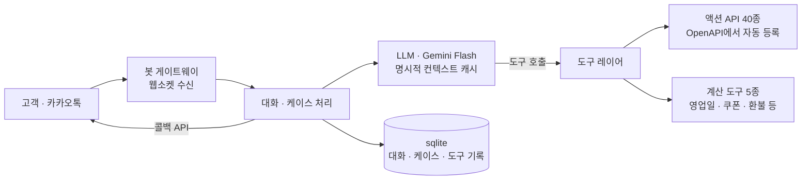

# 교동마을 산지직송 고객응대 AI 에이전트

카카오 AI TOP 100 예선 참가작입니다. 2037년을 배경으로 한 가상 시나리오 대회였고, 대회 당일(2026-10-31) 하루 동안 구현해서 제출했습니다.

> **공개 범위 안내**
> 대회에서 받은 자료(`knowledge/`)와 실제로 쓴 시스템 프롬프트는 공개하지 않았습니다.
> - `app/prompt.py`는 구조와 설계 원칙만 남긴 **요약본**입니다.
> - `app/coupons.py`, `app/refunds.py`의 금액과 구간 값은 **예시 값**입니다.
> - 그래서 이 저장소만으로는 대회 환경을 그대로 재현할 수 없고, `test_tc.py`도 `knowledge/tc`가 있어야 실행됩니다.
>
> 이 저장소는 코드 구조와 설계 판단, 개선 과정을 보여 주는 기록입니다.

## 문제 정의

- 과제: 가상 마을 「교동마을 산지직송」(제주 농산물과 위탁 수산물을 파는 온라인몰)의 카카오톡 고객응대 AI 에이전트를 만드는 것.
- 방식: 마을 관계자 10명(챗봇 페르소나)을 카카오톡으로 인터뷰해서 규정과 기록을 모으고, 액션 서버 API(40종)를 호출해 조회·처리·이관하는 에이전트를 직접 구현했습니다.
- 심사: 심사위원이 고객 역할로 30개 내외의 시나리오를 봇에 보내고, 인터뷰로 얻은 지식의 양, 응답 속도(p95), 케이스당 말풍선 수, 말풍선당 글자 수, 응답 정확도(API 수행 포함)를 봅니다.
- 제약: 텍스트 메시지만 사용, 말풍선당 500자, 60초 동안 응답이 없으면 케이스 종료, 케이스당 응답 10건 제한.

속도와 글자 수는 정확도에 따라 가중되는 구조여서, 정확도를 먼저 잡고 그다음에 줄이는 순서로 개선했습니다.

## 아키텍처

웹훅 서버 없이 게이트웨이에 연결해서 메시지를 받는 **상시 워커** 구조이고, 답변은 콜백 API로 돌려줍니다.

### 코드 구성

| 파일 | 역할 |
| --- | --- |
| `main.py` | 진입점 |
| `app/gateway.py`, `app/kakao.py` | 카카오톡 게이트웨이 연결과 메시지 송수신 |
| `app/handler.py` | 대화 · 케이스 처리 흐름 |
| `app/case.py` | 케이스 정보(식별자, 인입 시각) 파싱 |
| `app/llm.py` | LLM 호출, 캐시, 타임아웃 · 재시도, 예비 키 전환 |
| `app/actions.py` | 액션 API 도구 등록과 계산 도구 |
| `app/calendar.py`, `app/coupons.py`, `app/refunds.py` | 영업일 · 쿠폰 · 부분환불 계산 |
| `app/prompt.py` | 시스템 프롬프트 (공개용 요약본) |
| `test_tc.py` | 테스트 하네스 |
| `run_bot.ps1` | 죽으면 다시 띄우는 실행 러너 |

## 설계 결정

- **확실한 값은 코드가, 판단은 LLM이 합니다.** 영업일과 공휴일, 정기배송 마감, 다음 출고일, 쿠폰 조합, 부분환불 금액처럼 규칙으로 정해지는 값은 계산 도구로 넘겼습니다. 규칙이 많아질수록 LLM에게 숫자를 맡기는 것보다 정확하고, 검증도 쉽습니다.
- **액션 API 40종은 OpenAPI 문서에서 자동으로 도구로 등록**했습니다. 조회 결과는 캐시하고, 같은 접수가 다시 전송되지 않게 막고, 429와 5xx는 재시도합니다.
- **3단계 이관 구조**: 봇이 직접 처리하는 경우, 담당자에게 넘기는 경우, 클레임으로 올리는 경우를 나누고, 이관할 때는 확인된 사실과 확인되지 않은 사항을 구분해서 사유에 남깁니다.
- **위기 신호 규칙을 프롬프트 맨 위**에 두어 다른 규칙보다 먼저 적용되게 했습니다.
- **지식은 두 갈래로 나눴습니다.** 규칙과 판정 기준은 프롬프트에, 개별 데이터 행은 따로 빼서 필요할 때 API로 조회합니다. 프롬프트가 커질수록 속도와 비용이 같이 늘어서, 이 분리와 명시적 컨텍스트 캐시가 필수였습니다.
- **사진과 음성**은 카카오 CDN의 서명 URL을 내려받아 멀티모달 입력으로 넣었습니다.
- **대화와 케이스, 도구 호출 기록을 sqlite에 저장**해서 재시작해도 이어집니다.
- **LLM 호출은 15초 타임아웃에 1회 재시도**하고, 선불 크레딧이 떨어져 402가 나면 무료 예비 키로 자동 전환합니다.
- **운영**: 러너(`run_bot.ps1`)가 프로세스가 죽으면 10초 뒤 다시 띄우고, 부팅 시에는 작업 스케줄러가 로그인 없이 실행했습니다.

## 테스트 하네스

`test_tc.py`는 공개된 테스트 케이스를 자동으로 돌립니다.

1. 고객 역할은 LLM이 케이스의 "상황"을 연기합니다.
2. 에이전트는 연습용 액션 API를 실제로 호출합니다.
3. 기대한 API 호출과 실제 호출을 비교합니다.
4. 말풍선 수, 글자 수, 턴별 응답 시간, 재시도 횟수, 고정 문구(실패 응답) 횟수를 측정합니다.
5. 끝나면 연습 환경을 초기화합니다.

위기 신호와 라이브 방송 발언 같은 자체 케이스도 추가해서 같이 돌렸습니다.

| 실행 | 기대 API 누락 | 평균 글자 | 최장 응답 | 고정 문구 | 메모 |
| --- | --- | --- | --- | --- | --- |
| 1회차 | 11건 | 154자 | - | 1회 | 회원 조회가 과하고 이관이 빠짐 |
| 3회차 | 2건 | 124자 | 25.0초 | 1회 | 문서를 추가하면서 입력이 커짐 |
| 5회차 | 1건 | 139자 | 17.9초 | 0회 | 프롬프트를 줄이고 타임아웃 · 재시도 추가 |

## 수치

| 항목 | 결과 |
| --- | --- |
| 관계자 확보 | 10명 전원 |
| 평균 지식 발굴률 | 약 35% → 약 59% |
| 확보한 자료 | 약 49종 |
| 기대 API 누락 (공개 테스트 케이스 15개) | 11건 → 1건 |
| 고정 문구(실패 응답) | 0회 |
| 최장 응답 | 25.0초 → 17.9초 |
| 말풍선 | 턴당 1개 |
| 평균 글자 수 | 154자 → 약 120~140자 |
| 등록한 도구 | 45개 (액션 API 40 + 계산 도구 5) |
| 심사 예상 비용 | 30케이스 기준 약 $3.5, 최악 약 $8.5 |

## 트러블슈팅

- **같은 배송지 변경이 5번 접수됨** → 도구 결과를 대화 기록에 남기고 중복 접수를 막는 장치를 넣었습니다.
- **필요 없는 회원 조회가 남발됨** → 소유 확인이 필요한 경우(타인 정보 요구, 회원 단위 문의)에만 조회하도록 규칙을 정리했습니다.
- **프롬프트가 10만 자 넘게 커짐** → 데이터 행을 따로 빼고 중복을 제거해 7만 자 아래로 줄였습니다. 문서를 추가하면서 다시 9만 자대가 됐고, 그래서 캐시와 데이터 분리를 유지했습니다.
- **느린 턴의 원인을 입력 크기로 의심했는데 아니었음** → 모델 서버 쪽 지연이 가끔 튀는 것(중앙값 2.8초, 가끔 16~26초)이었고, 호출 타임아웃과 재시도로 대응했습니다.
- **선불 크레딧이 소진돼 모든 응답이 고정 문구로 나감(402)** → 충전하고, 무료 예비 키로 자동 전환되게 만들었습니다.
- **스케줄러가 관리자 권한으로 띄운 봇을 일반 권한 도구로 재시작할 수 없었음** → 관리자 권한 셸에서 프로세스를 종료하면 러너가 10초 뒤 다시 띄우도록 운영했습니다.

## 배운 점

- 인터뷰로 지식을 모을 때는 "자료를 주세요"보다 "고객이 이렇게 말하면 어떻게 하나요" 같은 구체적인 장면 질문이 잘 통했습니다. 받은 문서가 인용하는 다른 문서의 이름을 정확히 적어 다시 물으면, 처음엔 "없다"던 자료도 열렸습니다.
- 규칙이 많아질수록 LLM에게는 판단만 맡기고 숫자는 코드로 넘기는 분리가 정확도와 검증 가능성을 함께 올렸습니다.
- 프롬프트 크기, 지연, 비용은 같이 움직입니다. 캐시와 데이터 분리가 필수였습니다.
- 운영 문제(크레딧, 권한, 재시작, 네트워크)는 마지막 한 시간에 터졌습니다. 예비 키와 자동 재시작은 미리 만들어 두는 게 맞습니다.
- 정확도를 먼저 잡은 대가로 속도(p95)와 글자 수는 중간 수준에 머물렀습니다.

## 한계

- 프롬프트가 커서 속도와 비용이 늘었습니다.
- 마감 직전에 확보한 문서는 대화 테스트가 부족했습니다.
- 일부 턴은 글자 수가 120자를 넘습니다.
- 로컬 PC에서 운영해서 PC 전원과 네트워크에 의존했습니다.

## 환경 변수

`.env.example`에 이름만 있고 값은 비어 있습니다.

`ACTION_BASE_URL`, `ACTION_TOKEN`, `BOT_TOKEN`, `DATA_DIR`, `ENABLE_TOOLS`, `LLM_API_KEY`, `LLM_API_KEY_FALLBACK`, `LLM_CACHE_TTL`, `LLM_FALLBACK_TIMEOUT`, `LLM_MODEL`, `LLM_RETRIES`, `LLM_TIMEOUT`, `REPLY_DEADLINE`, `USE_EXPLICIT_CACHE`

`run_bot.ps1`은 `UV_EXE`(uv 실행 파일 경로)를 셸 환경에서 읽고, 없으면 `uv`를 씁니다.
